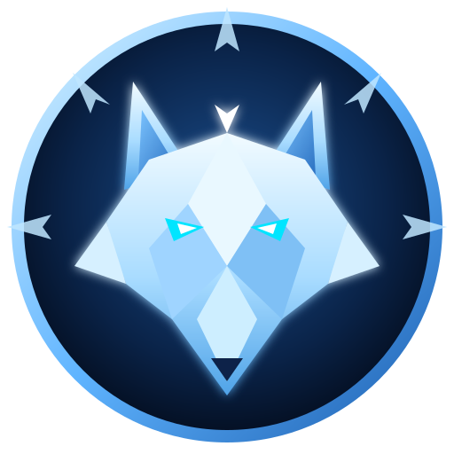

# Project Icewolf

**A private, fast and debloated browser with a frost-blue look.** 
Built on the LibreWolf engine. No telemetry, no AI, no accounts, no clutter.

**[⬇ Download the latest version](../../releases/latest)**

Want a video downloader built in? Check out the <a href="https://github.com/Hopi85/project-icewolf-getem"><b>Getem Edition</b></a>.

---

## ❄ Why Icewolf?

Most browsers send usage data home, push accounts and AI features, and fill the start page with news and sponsored tiles. Icewolf takes the privacy-focused **LibreWolf** browser and strips it down even further:

| | |
|---|---|
| 🔒 **Zero telemetry** | Built out of the engine by LibreWolf and locked off a second time by Icewolf. |
| 🧹 **Debloated** | No AI, no Mozilla account or Sync, no password manager, no translation, no Pocket, no promos. |
| 🛡 **Ad & tracker blocking** | uBlock Origin built in, strict tracking protection, HTTPS-only, encrypted DNS. |
| 🔍 **DuckDuckGo** | Default search, straight from the address bar. |
| 🧊 **Empty start page** | Just the Icewolf logo. No shortcuts, sponsors, news or ads. |
| 🌙 **Dark mode** | One click in the main menu. |
| 🔥 **Forget button** | A flame in the toolbar wipes your recent browsing data. |
| 💼 **Portable version** | Runs from any folder or USB stick, no installation needed. |
| 🔄 **Automatic updates** | New LibreWolf security updates are checked, verified and installed automatically. |

---

## ⬇ Download & install

Go to **[Releases](../../releases/latest)** and pick one:

| File | For |
|---|---|
| `IcewolfSetup-v<version>.exe` | **Installer**: installs Icewolf with a Start menu entry and automatic updates. |
| `IcewolfPortable-v<version>.zip` | **Portable**: extract anywhere and start `Icewolf.exe`. Nothing is installed. |

> **"Windows protected your PC"?** The setup isn't code-signed (a certificate costs money), so Windows warns about it. Click **More info → Run anyway**. On PCs with Windows 11 *Smart App Control* switched on, unsigned programs are blocked outright and Icewolf can't run there until it has a code-signing certificate. Each file has a `.sha256` checksum so you can check that your download wasn't altered.

**Import your bookmarks** from Chrome, Edge, Brave, Opera or Vivaldi: *Settings → General → Import browser data*.

---

## 🎬 Looking for a video downloader? Get the Getem Edition

**[Project Icewolf – Getem Edition](https://github.com/Hopi85/project-icewolf-getem)** is the same Icewolf browser with **Getem** built in, a video search and download tool.

| | |
|---|---|
|  **One-click button** | On a video page (YouTube, TikTok, …), click the red **G** in the toolbar and the video goes straight into Getem's download queue. |
| 📑 **Getem in a tab** | Search and manage your downloads inside an Icewolf tab, no extra window needed. |
| 💾 **Same choices** | Installer or portable version, with all the privacy and debloat features of this repository. |
| 🐍 **Requirement** | Python 3.11+ (Getem sets up its download components on first start). |

This repository stays the **plain browser**, without any download tool. Pick whichever fits you:

| | Project Icewolf | Getem Edition |
|---|:---:|:---:|
| Private, debloated browser | ✅ | ✅ |
| uBlock Origin, DuckDuckGo, empty start page | ✅ | ✅ |
| Installer & portable version | ✅ | ✅ |
| Built-in video downloader (Getem) | – | ✅ |
| Needs Python | – | only for Getem |

**[➜ Go to the Getem Edition](https://github.com/Hopi85/project-icewolf-getem)**

---

## 🧹 What's removed

| Area | Status |
|---|---|
| Telemetry | Removed by LibreWolf and locked off by Icewolf (Glean, studies, crash reports, region lookup, attribution) |
| Mozilla account / Sync | Removed: disabled, locked and hidden |
| Password manager & autofill | Removed: disabled, locked and hidden |
| AI | Removed: chatbot, link previews, smart tab groups, AI history search, Google Lens |
| Start page & new tab | Empty except for the Icewolf logo |
| Translation, "More tools", default-browser prompt | Removed and hidden |
| Other bloat | Firefox View, Pocket, screenshots, shopping checker, Reader View, promos, push notifications, autostart |
| Branding | Icewolf everywhere: window, taskbar, About, Settings and Windows prompts |

All settings are **locked**, so updates can't bring anything back.

---

## 🛡 Privacy & security

- **Blocking:** uBlock Origin (with malware and phishing lists) plus strict tracking protection.
- **Connections:** HTTPS-only mode, encrypted DNS (Quad9), no WebRTC IP leaks, TLS 1.2+.
- **Hardening:** strict certificate pinning, no JavaScript in PDFs, add-ons injected by other programs are blocked.
- **Fingerprinting:** Firefox's fingerprinting protection is on. LibreWolf's stricter "resist fingerprinting" mode is off, because it breaks dark mode and time zones.
- **Verified engine:** every build and every update checks LibreWolf's official checksum and the digital signature of every program file (each one must be signed by LibreWolf's publisher; only Microsoft's C++ runtime files may carry Microsoft's signature). If anything doesn't match, it stops. Note: `icewolf.exe` itself is a rebranded copy of LibreWolf's signed `librewolf.exe`, so it carries no signature (Windows may warn about it, see the note on the setup above).
- **Deliberate trade-offs (inherited from LibreWolf):** Google Safe Browsing is off (it would send data to Google), and certificate revocation is checked with CRLite instead of OCSP (OCSP tells the certificate authority which sites you visit). Encrypted DNS falls back to your normal DNS if Quad9 can't be reached, so the browser keeps working on networks that block it.
- **The only connections left:** engine updates, uBlock filter lists, security blocklists and encrypted DNS. None of them sends browsing or usage data.

---

## 💡 Good to know

- **Logged out after closing?** Cookies are deleted when Icewolf closes (a LibreWolf default). To stay logged in: *Settings → Privacy & Security* → untick deleting cookies on close.
- **Your own `librewolf.overrides.cfg` is not used.** Icewolf's settings are part of its program files, and LibreWolf's per-user overrides file is switched off: Icewolf runs its own browser scripts with full rights, and that file would run the same way, so any program on the PC could have used it to change the browser. Change settings in `user.js` (see below) instead.
- **Netflix / Spotify don't play?** DRM (Widevine) is off by default, and Icewolf switches it off again on every start. To keep it on, open `user.js` in your profile folder (portable: `profile\user.js`), change `media.eme.enabled` to `true`, and restart Icewolf.
- **A 3D site or game doesn't load?** WebGL is off for privacy. Set `webgl.disabled` to `false` in `user.js`.
- **Pin to taskbar:** open the Start menu, right-click **Icewolf**, choose **Pin to taskbar**.

---

## 🔧 Build it yourself

No extra software needed, only Windows' built-in tools:

1. Download this repository (**Code → Download ZIP**) and extract it.
2. Double-click **`Build-Icewolf-Setup.bat`**.
3. The `dist` folder opens with the installer and the portable version.

The build downloads the newest signed LibreWolf release from LibreWolf's official servers and **stops unless** the checksum matches and every program file is validly signed by LibreWolf's publisher (or, for Microsoft's C++ runtime files, by Microsoft). The installer checks the signatures again on each PC. If something fails, `build-log.txt` explains why.

GitHub also builds Icewolf automatically every week and for every version tag (`v1.0`, `v1.1`, …), see [`.github/workflows`](.github/workflows).

Project layout

| Path | Contents |
|---|---|
| `build.ps1`, `Build-Icewolf-Setup.bat` | Build script and one-click starter |
| `setup/` | Installer, portable launcher and updater (C#) |
| `icewolf/config/` | Browser settings: `user.js`, policies, locked prefs, theme (`userChrome.css`, `userContent.css`) |
| `icewolf/branding/`, `setup/assets/` | Logo and artwork |

---

## 📜 License & credits

- **Project Icewolf** is licensed under the **[Mozilla Public License 2.0](LICENSE)**.
- **Browser engine:** [LibreWolf](https://librewolf.net), based on Mozilla Firefox (MPL 2.0). The release files contain LibreWolf's signed program files. Source code: <https://codeberg.org/librewolf>.
- **Ad blocker:** uBlock Origin (GPLv3), bundled by LibreWolf.

Icewolf is an independent project and not affiliated with LibreWolf or Mozilla. Firefox is a trademark of the Mozilla Foundation.

---

## ☕ Support the project

If you like Icewolf and want to support its development, you can buy me a coffee:

